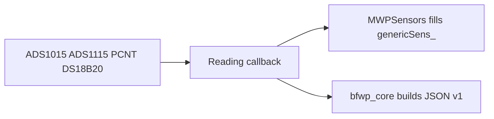

# 09 — Reuse MWPSensors without sharing its message format

Status: **draft**. This is a design note for sharing sensor drivers with
[MWPSensors](https://github.com/whitejv/MWPSensors). It does not change the v1 message
contract. Firmware behavior stays in [`07-firmware-design.md`](07-firmware-design.md).
Hardware facts stay in [`../../hardware.md`](../../hardware.md).

The hardware match is real, and the firmware design already points at MWPSensors. The
board, I2C pins, ADS1015 at `0x48`, ADS1115 at `0x49`, flow on GPIO7, DS18B20 on GPIO6,
and the optional fan on GPIO2 are the same. What does not match is the data product:
MWPSensors fills a 104-byte `genericSens_` union and publishes binary QoS 2 plus a local
JSON QoS 0 stream. BFWP's twin, ingest, and MCP already speak spec v1 JSON over TLS.
Reuse the drivers. Do not reuse the struct or the publisher.

## What is worth sharing

These files under `components/sensor_system/` are the reusable core. Today each one writes
`genericSens_` directly, which is why a straight copy will not serve both apps. The change
in both trees is the same: the manager returns a reading, and the app decides what to do
with it.

- `i2c_manager` plus `i2c_adc_manager` (`espp/ads1x15`). Keep the bus, the retries, and
  both ADC addresses. MWP reads all 8 channels once a second into `adc_x1`–`adc_x8`. BFWP
  needs current and pressure every 100 ms, converted to amps and psi on the device. The
  driver can run at either period; the channel-to-meaning map and the volts-to-amps factor
  are still open (hardware H7, H9).
- `pcnt_flow_manager` for one GPIO7 counter and its glitch filter. MWP treats PCNT as the
  primary meter for up to 3 Hall sensors and accumulates over 2 seconds. BFWP has one
  isolated gallon pulse. A 2-second window cannot see a slow leak (one pulse every couple
  of minutes), so BFWP's primary path stays a timestamped GPIO interrupt, with PCNT only
  as the cross-check already described in the firmware design.
- `onewire_temp_manager` for a single DS18B20. MWP's five-sensor bus and 5-second interval
  can stay; BFWP registers one sensor and puts `enclosure_f` in `health`.
- `wifi_manager`, `watchdog`, `panic_stats`, `error_recovery`, and the dev-only
  `task_monitor`. Same reconnect, heartbeat, and reset-reason behavior. Credentials move
  to gitignored `secrets.h`. MWP's `config.h` compile-time Wi-Fi and MQTT defines do not
  come across.
- Fan control on GPIO2, still optional.

## What BFWP still has to write

MWPSensors does not have these, including the SNTP and OTA notes, which are design
documents rather than running code:

- SNTP, and no publish until the clock is set.
- NVS for `seq`, `gal_total`, and calibration (`calib_id`).
- Offline flash buffer and batches of up to 100 records.
- Spec v1 JSON: telemetry, events, health, retained status, and Last Will. TLS to HiveMQ,
  QoS 1.
- Cadence and event rules already implemented by the twin (`bfwp_core`, no ESP-IDF calls).
- Pulse timestamps so `gpm` comes from the time between gallons.

## What not to bring over

- `genericSens_`, binary MQTT, and the dual JSON publish in `mqtt_publisher` /
  `mqtt_manager`.
- `i2c_gpio_manager` (MCP23017) and `i2c_env_manager` (BME280). The well board does not
  have them.
- Extra flow channels and extra temperature sensors.
- Downstream conversion on a Pi. BFWP converts on the ESP32.
- The committed build debris in that repo (`CMakeCache.txt`, `sdkconfig`, `.DS_Store`).
  Depend on `espressif/onewire_bus` and `espp/ads1x15` the way
  [idf_component.yml](https://github.com/whitejv/MWPSensors/blob/main/components/sensor_system/idf_component.yml)
  does.

## How to change both

Give the ADC, PCNT, and One-Wire managers a sink callback (volts, pulse count, degrees)
instead of a hard-coded write into `genericSens_`. MWP's existing publisher keeps filling
the union, so the Pi receiver does not change. BFWP's `bfwp_hal` implements the same
callbacks and hands engineering units to `bfwp_core`. That is the reuse. A third shared
component is worthwhile only after those callbacks exist in both trees; copying the
managers in unchanged will drag the binary struct into the well monitor.

## Infrastructure worth adding back to MWPSensors

The useful changes tell the Pi when a sample happened and whether any samples were lost.
They belong on the JSON topic. The 104-byte `genericSens_` layout in
[sensor.h](https://github.com/whitejv/MWPSensors/blob/main/components/sensor_system/include/sensor.h)
is frozen: it has `cycle_count` (it wraps at 28800) and a flow window of pulses plus
milliseconds, and it has no UTC time and no gap-detecting sequence. Adding fields there
would break the Pi receiver.

[notes/FUTURE_UPGRADES.md](https://github.com/whitejv/MWPSensors/blob/main/notes/FUTURE_UPGRADES.md)
already specifies SNTP (`pool.ntp.org`, `time.nist.gov`, hourly, UTC) and a timestamp on
JSON. That note is the right design. It is not in the firmware yet.

Worth putting back, in this order:

1. **SNTP and UTC epoch milliseconds.** Do not publish a JSON timestamp until the first
   sync. If NTP drops later, keep the clock and keep publishing. Leave the binary frame
   unchanged so the Pi does not have to change the same day.
2. **A `seq` that is never reused.** Store it in NVS about every 100 publishes. On boot,
   jump ahead by 100 so a crash cannot repeat a number. Leave `cycle_count` as it is.
   The Pi uses `seq` to see the hole after a Wi-Fi drop.
3. **A short RAM ring of samples that did not get published, sent oldest-first after
   reconnect.** QoS 2 does not help while the broker is down. A fixed client id and a
   persistent session cover the smaller case where only the ESP rebooted and the broker
   stayed up. Flash can wait. That same upgrades note already treats an SPI chip as a
   later option.
4. **Last Will, plus the reset reason and Wi-Fi reconnect count that `panic_stats`
   already collects,** on the existing monitor JSON topic. Then the Pi can tell "the
   device is off" from "the device is quiet."
5. **Wi-Fi and MQTT credentials out of `config.h` and into a gitignored header.** The
   binary layout does not change.

Leave these on the well-monitor side only: the 1-second-or-idle publishing cadence, pump
and leak event rules, converting volts to psi and amps on the ESP32, and TLS to HiveMQ.
The buzzer and the HTTP log path in that upgrades note are separate products, not this
infrastructure.
